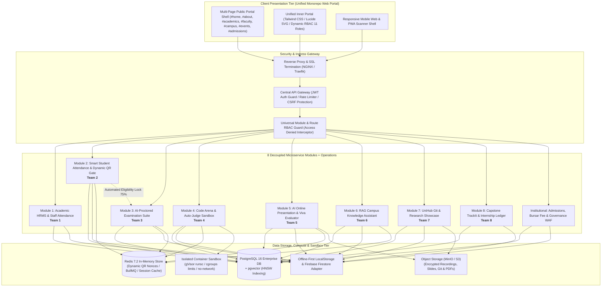
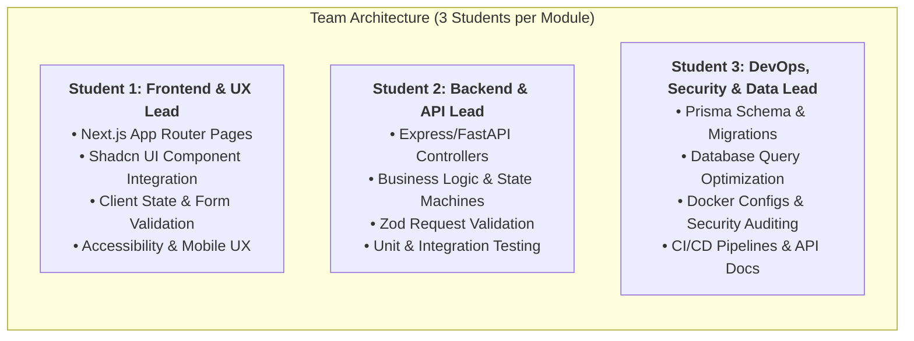

# UniSphere: Enterprise Unified Academic Portal & Autonomous Campus Ecosystem
## Master System Architecture, Student Team Implementation Blueprint & Cybersecurity Audit
**Version 2.5 | Lead Architect Specification | Academic Year 2026-27**

---

## Executive Summary & Integration Strategy

The modern university requires a unified digital campus platform that seamlessly connects human capital management, smart student attendance verification, high-stakes academic examinations, practical coding education, AI-evaluated presentation defenses, automated knowledge discovery, and an institutional intellectual property repository.

To eliminate legacy administrative silos and proxy attendance vulnerabilities, the **UniSphere Platform** unifies 8 mission-critical autonomous subsystems and enterprise administrative modules:
1. **Module 1 (Team 1)**: Enterprise Academic HRMS, Faculty Workload & Staff Attendance System (`EduHRMS`)
2. **Module 2 (Team 2)**: Smart Campus Student Attendance Tracking, Dynamic Geo-QR & Exam Eligibility Engine (`EduAttend AI`)
3. **Module 3 (Team 3)**: AI-Proctored Intelligent Examination & Comprehensive Academic Evaluation Suite (`EduExam AI / ExamShield`)
4. **Module 4 (Team 4)**: Cloud-Based Code Execution Arena, Auto-Judge & Plagiarism Detection Engine (`EduCode Judge / CodeArena`)
5. **Module 5 (Team 5)**: AI-Powered Online Presentation, Virtual Viva Voce & Multi-Modal Evaluation Platform (`EduPresent AI / PresentAI`)
6. **Module 6 (Team 6)**: Institutional Knowledge Base & Context-Aware Conversational AI Assistant (`EduAssist AI / CampusBot`)
7. **Module 7 (Team 7)**: Institutional Source Code Repository, Academic Research Archive & Innovation Activity Network (`UniHub`)
8. **Module 8 (Team 8)**: Capstone Project Tracking, Industry Internships, Guide Rubric & Milestone Audit System (`TrackIt`)
9. **Administrative Operations**: Admissions Pipeline & Digital Pass Issuer, Bursar & Student Fee Ledgers, Governance & Security WAF Center, and Multi-Page Public Web Portal.

### Multi-Team Engineering Strategy (8 Teams × 3 Students = 24 Students)
Each module is engineered by an independent team of **3 students** (total 24 students). To eliminate interface collisions while preserving complete domain ownership:
- All teams adhere to a **common technology stack** (React 18 / Next.js, TypeScript 5, Tailwind CSS, Node.js/Express, Python multi-modal/AI workers, PostgreSQL 16 with `pgvector`, Redis 7.2).
- Projects are decoupled via **RESTful JSON contracts** managed by a central **Portal Gateway** with Single Sign-On (SSO).
- Code is coordinated in a single **Monorepo** with strict branch protection rules, circuit breakers, isolated storage partitions, and automated quality gates.
- In the student project assignment catalog, each project is presented as an autonomous, self-contained system so teams focus solely on their dedicated scope without realizing their module is part of a larger staged puzzle until integration time.

---

## 1. Global System Architecture Diagram



---

## 2. Standardized Technology Stack Matrix

| Architecture Tier | Technology Selection | Technical Justification & Standards |
| :--- | :--- | :--- |
| **Frontend Framework** | **Next.js 14 (App Router) + TypeScript** | Server-Side Rendering (SSR), strict static typing, route handlers, zero layout shift. |
| **Design System & UI** | **Tailwind CSS + Shadcn/UI + Framer Motion** | Consistent styling tokens, WCAG 2.1 AA accessibility, fluid animations, responsive layouts. |
| **Backend Services** | **Node.js 20 LTS + Express.js (TypeScript)** | High-throughput asynchronous I/O, shared TypeScript interfaces with frontend, Zod validation. |
| **AI & Multi-Modal** | **Python 3.11 + FastAPI + Whisper/Vosk + MediaPipe** | Real-time speech-to-text, eye contact/gaze metrics, face liveness, and context-grounded RAG embeddings. |
| **Video Streaming** | **WebRTC (LiveKit / Mediasoup) + PDF.js** | Low-latency presentation broadcast with synchronized slide decks and evaluator controls. |
| **Relational Database** | **PostgreSQL 16 + Prisma ORM** | ACID transactions, strict referential integrity, schema migration versioning. |
| **Vector Database** | **PostgreSQL `pgvector` Extension** | Native high-dimensional vector embeddings (1536-dim) with HNSW cosine similarity search. |
| **In-Memory & Queues** | **Redis 7.2 + BullMQ** | 5-second rotating QR nonce validation, rate-limiting, and async code execution worker queues. |
| **Isolated Execution** | **Docker Engine SDK + gVisor (`runsc`)** | Multi-tenant code execution sandboxing with CPU/RAM cgroups and network isolation. |
| **Storage Tier** | **MinIO (S3-Compatible Object Store)** | Self-hosted distributed storage for presentation recordings, slides, Git repositories, and research PDFs. |

---

## 3. Team Organization & Role Distribution (3 Students per Module)

To maximize learning outcomes and prevent overlapping commits, each 3-student team is divided into precise engineering responsibilities:



### Module 1 (Team 1): Academic HRMS & Staff Attendance (EduHRMS)
- **Student 1 (Frontend & UX Lead)**: Builds faculty and staff dossier interfaces, interactive leave request modals, visual attendance dashboards with geolocation map pins, and monthly payroll history views.
- **Student 2 (Backend & API Architect)**: Implements multi-level leave approval state machines (Faculty → HOD → Dean → Registrar), payroll calculation engine with PF/tax slabs, and workload credit balancing algorithms.
- **Student 3 (DevOps, Security & Data Specialist)**: Architects normalized PostgreSQL HR schema, builds automated PDF payslip generation pipeline (PDFKit), implements role-based access control (RBAC), and manages audit logs.

### Module 2 (Team 2): Smart Student Attendance & Exam Eligibility (EduAttend AI)
- **Student 1 (Frontend & Scanner UX Lead)**: Builds dynamic rotating QR display console for classroom projectors, mobile QR scanner with camera permissions, and student course-wise attendance tracking cards.
- **Student 2 (Backend & Geo-Fencing Architect)**: Implements 5-second rotating HMAC-SHA256 QR nonces in Redis, geofencing polygon validator, and automated exam eligibility calculation service (75% rule).
- **Student 3 (AI Vision, Security & Condonation Lead)**: Deploys MediaPipe facial recognition kiosk with liveness blink verification, builds medical certificate OCR upload workflow, and configures defaulter SMS/email alerts.

### Module 3 (Team 3): AI-Proctored Intelligent Examination Suite (EduExam AI)
- **Student 1 (Frontend & Exam Shell Lead)**: Creates full-screen lockdown test environment, disables keyboard shortcuts (Ctrl+C, Ctrl+V, Alt+Tab), builds KaTeX formula editor, and develops responsive question runner.
- **Student 2 (Backend & Realtime Telemetry)**: Implements randomized question shuffler, time-synchronized WebSocket heartbeats, incremental auto-save (IndexedDB + REST sync), and auto-grading engine.
- **Student 3 (AI Proctoring & Integrity Specialist)**: Integrates client-side MediaPipe/TensorFlow.js face & gaze tracking, audio level analyzer, violation snapshot aggregator, and automated academic integrity score calculator.

### Module 4 (Team 4): Cloud Code Execution Arena & Auto-Judge (EduCode Judge)
- **Student 1 (Frontend & IDE Experience Lead)**: Integrates Monaco Editor with custom dark themes, stdin/stdout console panels, language selectors (Python, C++, Java, JS), and real-time contest leaderboards.
- **Student 2 (Judge Backend & Task Queues)**: Implements BullMQ distributed worker queue, manages test-case evaluation logic, and formats verdicts (Accepted, WA, TLE, MLE, Runtime Error).
- **Student 3 (Sandbox Security & AST Plagiarism)**: Deploys isolated Docker container runners with gVisor kernel jails, strict cgroups limits (256MB RAM, 1 CPU, no network), and develops Python AST token similarity checker.

### Module 5 (Team 5): AI-Powered Online Presentation, Virtual Viva & Multi-Modal Evaluator (EduPresent AI)
- **Student 1 (WebRTC Studio & Presentation UX Lead)**: Builds live WebRTC presentation stage, synchronized PDF/PPTX slide viewer with presenter laser pointer, and interactive evaluator scoring panel.
- **Student 2 (Multi-Modal AI Pipeline Architect)**: Implements audio transcription (Whisper/Vosk), calculates words-per-minute pace, detects filler words ('um', 'like'), and builds AI viva question generator.
- **Student 3 (Computer Vision & Slide Alignment Specialist)**: Deploys MediaPipe eye contact and posture tracking, computes semantic alignment between speech and slide text via embeddings, and generates PDF dossiers.

### Module 6 (Team 6): Institutional Knowledge Base & Conversational AI Assistant (EduAssist AI)
- **Student 1 (Conversational UX Lead)**: Creates streaming AI chat interface with markdown formatting, syntax-highlighted code blocks, citation link popups, and interactive tutor mode controls.
- **Student 2 (RAG Pipeline & Ingestion Engineer)**: Implements PDF/Docx text extraction, semantic chunking, embedding generation, hybrid search orchestration, and helpdesk escalation ticketing.
- **Student 3 (Vector Database & Prompt Security)**: Configures PostgreSQL `pgvector` with HNSW cosine indexes, role-scoped data partitions, system prompt injection filters, and latency benchmarking.

### Module 7 (Team 7): UniHub Git Code Repository & Research Archive (UniHub)
- **Student 1 (Git Web UI & Discovery Lead)**: Builds file tree navigation, visual commit branch graphs, side-by-side code diff viewer, PDF research manuscript reader, and student project showcases.
- **Student 2 (Git Engine & Paper Indexer)**: Implements Git HTTP smart protocol backend (packfiles, commits, trees), BibTeX citation generator, and manuscript metadata extraction pipeline.
- **Student 3 (Storage, Activity Feeds & Security)**: Sets up MinIO S3 object storage for Git bare repositories & PDF papers, builds real-time campus activity event stream, and enforces repo access control.

---

## 4. Entity-Relationship (ER) Strategy & Database Schema

### 4.1 Production Table DDL Specifications

```sql
-- 1. CENTRAL IDENTITY & ACCESS TABLES
CREATE TABLE departments (
 id UUID PRIMARY KEY DEFAULT gen_random_uuid(),
 code VARCHAR(16) UNIQUE NOT NULL,
 name VARCHAR(128) NOT NULL,
 faculty_dean_id UUID,
 budget NUMERIC(14,2) DEFAULT 0.00,
 created_at TIMESTAMPTZ DEFAULT CURRENT_TIMESTAMP
);

CREATE TYPE user_role_enum AS ENUM ('SUPER_ADMIN', 'DEAN', 'HOD', 'FACULTY', 'STAFF', 'STUDENT', 'TEACHING_ASSISTANT');

CREATE TABLE users (
 id UUID PRIMARY KEY DEFAULT gen_random_uuid(),
 email VARCHAR(255) UNIQUE NOT NULL,
 password_hash VARCHAR(255) NOT NULL,
 full_name VARCHAR(128) NOT NULL,
 role user_role_enum NOT NULL,
 dept_id UUID REFERENCES departments(id) ON DELETE SET NULL,
 is_active BOOLEAN DEFAULT TRUE,
 created_at TIMESTAMPTZ DEFAULT CURRENT_TIMESTAMP,
 updated_at TIMESTAMPTZ DEFAULT CURRENT_TIMESTAMP
);

-- 2. MODULE 1: HRMS & WORKFORCE TABLES
CREATE TABLE hrms_faculty_profiles (
 id UUID PRIMARY KEY DEFAULT gen_random_uuid(),
 user_id UUID UNIQUE NOT NULL REFERENCES users(id) ON DELETE CASCADE,
 designation VARCHAR(64) NOT NULL,
 tenure_status VARCHAR(32) DEFAULT 'PROBATION',
 base_salary NUMERIC(12,2) NOT NULL,
 max_teaching_credits INT DEFAULT 16,
 emergency_contact VARCHAR(64),
 created_at TIMESTAMPTZ DEFAULT CURRENT_TIMESTAMP
);

CREATE TYPE leave_status_enum AS ENUM ('PENDING_HOD', 'PENDING_DEAN', 'APPROVED', 'REJECTED', 'CANCELLED');

CREATE TABLE hrms_leave_requests (
 id UUID PRIMARY KEY DEFAULT gen_random_uuid(),
 user_id UUID NOT NULL REFERENCES users(id) ON DELETE CASCADE,
 leave_type VARCHAR(32) NOT NULL,
 start_date DATE NOT NULL,
 end_date DATE NOT NULL,
 reason TEXT NOT NULL,
 status leave_status_enum DEFAULT 'PENDING_HOD',
 approved_by UUID REFERENCES users(id),
 created_at TIMESTAMPTZ DEFAULT CURRENT_TIMESTAMP
);

CREATE TABLE hrms_workload_allocations (
 id UUID PRIMARY KEY DEFAULT gen_random_uuid(),
 faculty_id UUID NOT NULL REFERENCES users(id) ON DELETE CASCADE,
 semester VARCHAR(32) NOT NULL,
 course_code VARCHAR(16) NOT NULL,
 course_name VARCHAR(128) NOT NULL,
 lecture_hours INT NOT NULL DEFAULT 3,
 lab_hours INT NOT NULL DEFAULT 0,
 credits INT NOT NULL DEFAULT 4
);

CREATE TABLE hrms_payroll_records (
 id UUID PRIMARY KEY DEFAULT gen_random_uuid(),
 user_id UUID NOT NULL REFERENCES users(id) ON DELETE CASCADE,
 month_year VARCHAR(16) NOT NULL,
 basic_pay NUMERIC(12,2) NOT NULL,
 allowances NUMERIC(12,2) DEFAULT 0.00,
 deductions NUMERIC(12,2) DEFAULT 0.00,
 net_pay NUMERIC(12,2) NOT NULL,
 pdf_slip_url VARCHAR(512),
 created_at TIMESTAMPTZ DEFAULT CURRENT_TIMESTAMP
);

-- 3. MODULE 2: SMART STUDENT ATTENDANCE & ELIGIBILITY TABLES
CREATE TABLE attend_courses (
 id UUID PRIMARY KEY DEFAULT gen_random_uuid(),
 code VARCHAR(16) UNIQUE NOT NULL,
 name VARCHAR(128) NOT NULL,
 dept_id UUID REFERENCES departments(id),
 faculty_id UUID REFERENCES users(id),
 min_attendance_percentage NUMERIC(5,2) DEFAULT 75.00
);

CREATE TABLE attend_sessions (
 id UUID PRIMARY KEY DEFAULT gen_random_uuid(),
 course_id UUID NOT NULL REFERENCES attend_courses(id) ON DELETE CASCADE,
 session_date DATE NOT NULL,
 start_time TIME NOT NULL,
 end_time TIME NOT NULL,
 room_polygon JSONB NOT NULL, -- GPS polygon coordinates
 ble_beacon_uuid VARCHAR(128),
 qr_secret VARCHAR(64) NOT NULL,
 is_active BOOLEAN DEFAULT TRUE,
 created_at TIMESTAMPTZ DEFAULT CURRENT_TIMESTAMP
);

CREATE TABLE attend_student_logs (
 id UUID PRIMARY KEY DEFAULT gen_random_uuid(),
 session_id UUID NOT NULL REFERENCES attend_sessions(id) ON DELETE CASCADE,
 student_id UUID NOT NULL REFERENCES users(id) ON DELETE CASCADE,
 checkin_method VARCHAR(32) NOT NULL, -- 'DYNAMIC_QR', 'GEOFENCE_BLE', 'FACIAL_KIOSK'
 device_latitude NUMERIC(10,7),
 device_longitude NUMERIC(10,7),
 is_verified BOOLEAN DEFAULT TRUE,
 timestamp TIMESTAMPTZ DEFAULT CURRENT_TIMESTAMP,
 UNIQUE(session_id, student_id)
);

CREATE TABLE attend_condonations (
 id UUID PRIMARY KEY DEFAULT gen_random_uuid(),
 student_id UUID NOT NULL REFERENCES users(id) ON DELETE CASCADE,
 course_id UUID NOT NULL REFERENCES attend_courses(id) ON DELETE CASCADE,
 medical_cert_url VARCHAR(512) NOT NULL,
 ocr_extracted_data JSONB,
 days_requested INT NOT NULL,
 status VARCHAR(32) DEFAULT 'PENDING_HOD',
 approved_by UUID REFERENCES users(id),
 created_at TIMESTAMPTZ DEFAULT CURRENT_TIMESTAMP
);

-- 4. MODULE 3: EXAM & PROCTORING TABLES
CREATE TABLE exam_assessments (
 id UUID PRIMARY KEY DEFAULT gen_random_uuid(),
 title VARCHAR(255) NOT NULL,
 course_id UUID REFERENCES attend_courses(id),
 scheduled_start TIMESTAMPTZ NOT NULL,
 duration_minutes INT NOT NULL,
 total_marks INT NOT NULL,
 is_proctored BOOLEAN DEFAULT TRUE,
 created_by UUID REFERENCES users(id)
);

CREATE TABLE exam_questions (
 id UUID PRIMARY KEY DEFAULT gen_random_uuid(),
 exam_id UUID NOT NULL REFERENCES exam_assessments(id) ON DELETE CASCADE,
 question_type VARCHAR(16) NOT NULL, -- 'MCQ', 'MULTI_SELECT', 'ESSAY'
 prompt_text TEXT NOT NULL,
 options_json JSONB,
 correct_answer_json JSONB,
 marks NUMERIC(5,2) NOT NULL
);

CREATE TABLE exam_submissions (
 id UUID PRIMARY KEY DEFAULT gen_random_uuid(),
 exam_id UUID NOT NULL REFERENCES exam_assessments(id) ON DELETE CASCADE,
 student_id UUID NOT NULL REFERENCES users(id) ON DELETE CASCADE,
 answers_json JSONB DEFAULT '{}'::jsonb,
 score NUMERIC(6,2),
 status VARCHAR(32) DEFAULT 'IN_PROGRESS',
 integrity_rating INT DEFAULT 100,
 submitted_at TIMESTAMPTZ
);

CREATE TABLE exam_proctor_violations (
 id UUID PRIMARY KEY DEFAULT gen_random_uuid(),
 submission_id UUID NOT NULL REFERENCES exam_submissions(id) ON DELETE CASCADE,
 event_type VARCHAR(64) NOT NULL, -- 'TAB_SWITCH', 'MULTI_FACE', 'NO_FACE', 'AUDIO_FLAG'
 snapshot_url VARCHAR(512),
 timestamp TIMESTAMPTZ DEFAULT CURRENT_TIMESTAMP,
 severity VARCHAR(16) DEFAULT 'MEDIUM'
);

-- 5. MODULE 4: CODING ARENA & AUTO-JUDGE TABLES
CREATE TABLE coding_problems (
 id UUID PRIMARY KEY DEFAULT gen_random_uuid(),
 title VARCHAR(255) NOT NULL,
 slug VARCHAR(255) UNIQUE NOT NULL,
 difficulty VARCHAR(16) NOT NULL,
 time_limit_ms INT DEFAULT 2000,
 memory_limit_mb INT DEFAULT 256,
 description_md TEXT NOT NULL,
 tags TEXT[]
);

CREATE TABLE coding_test_cases (
 id UUID PRIMARY KEY DEFAULT gen_random_uuid(),
 problem_id UUID NOT NULL REFERENCES coding_problems(id) ON DELETE CASCADE,
 input_data TEXT NOT NULL,
 expected_output TEXT NOT NULL,
 is_hidden BOOLEAN DEFAULT TRUE,
 points INT DEFAULT 10
);

CREATE TABLE coding_submissions (
 id UUID PRIMARY KEY DEFAULT gen_random_uuid(),
 problem_id UUID NOT NULL REFERENCES coding_problems(id) ON DELETE CASCADE,
 student_id UUID NOT NULL REFERENCES users(id) ON DELETE CASCADE,
 language VARCHAR(32) NOT NULL,
 source_code TEXT NOT NULL,
 verdict VARCHAR(32) DEFAULT 'QUEUED',
 execution_time_ms INT,
 memory_used_mb NUMERIC(6,2),
 created_at TIMESTAMPTZ DEFAULT CURRENT_TIMESTAMP
);

CREATE TABLE coding_plagiarism_audits (
 id UUID PRIMARY KEY DEFAULT gen_random_uuid(),
 submission_a_id UUID NOT NULL REFERENCES coding_submissions(id),
 submission_b_id UUID NOT NULL REFERENCES coding_submissions(id),
 similarity_score NUMERIC(5,2) NOT NULL,
 ast_token_matches JSONB,
 flagged_at TIMESTAMPTZ DEFAULT CURRENT_TIMESTAMP
);

-- 6. MODULE 5: AI ONLINE PRESENTATION & VIVA TABLES
CREATE TABLE present_sessions (
 id UUID PRIMARY KEY DEFAULT gen_random_uuid(),
 presenter_id UUID NOT NULL REFERENCES users(id) ON DELETE CASCADE,
 course_id UUID REFERENCES attend_courses(id),
 title VARCHAR(255) NOT NULL,
 slide_deck_url VARCHAR(512) NOT NULL,
 recording_url VARCHAR(512),
 status VARCHAR(32) DEFAULT 'SCHEDULED',
 created_at TIMESTAMPTZ DEFAULT CURRENT_TIMESTAMP
);

CREATE TABLE present_slides (
 id UUID PRIMARY KEY DEFAULT gen_random_uuid(),
 session_id UUID NOT NULL REFERENCES present_sessions(id) ON DELETE CASCADE,
 slide_number INT NOT NULL,
 slide_text TEXT NOT NULL,
 key_topics TEXT[],
 visual_balance_score NUMERIC(4,2)
);

CREATE TABLE present_evaluations (
 id UUID PRIMARY KEY DEFAULT gen_random_uuid(),
 session_id UUID UNIQUE NOT NULL REFERENCES present_sessions(id) ON DELETE CASCADE,
 speech_pace_wpm INT NOT NULL,
 filler_word_count INT NOT NULL,
 filler_words_json JSONB,
 eye_contact_percentage NUMERIC(5,2) NOT NULL,
 slide_semantic_match_score NUMERIC(5,2) NOT NULL,
 total_rubric_score NUMERIC(5,2) NOT NULL,
 pdf_dossier_url VARCHAR(512),
 evaluated_at TIMESTAMPTZ DEFAULT CURRENT_TIMESTAMP
);

CREATE TABLE present_viva_qa (
 id UUID PRIMARY KEY DEFAULT gen_random_uuid(),
 session_id UUID NOT NULL REFERENCES present_sessions(id) ON DELETE CASCADE,
 question_text TEXT NOT NULL,
 student_response_transcript TEXT,
 correctness_score NUMERIC(4,2),
 examiner_notes TEXT
);

-- 7. MODULE 6: RAG KNOWLEDGE BASE & AI BOT
CREATE EXTENSION IF NOT EXISTS vector;

CREATE TABLE ai_knowledge_documents (
 id UUID PRIMARY KEY DEFAULT gen_random_uuid(),
 title VARCHAR(255) NOT NULL,
 category VARCHAR(64) NOT NULL,
 file_path VARCHAR(512) NOT NULL,
 target_roles user_role_enum[],
 is_indexed BOOLEAN DEFAULT FALSE,
 uploaded_at TIMESTAMPTZ DEFAULT CURRENT_TIMESTAMP
);

CREATE TABLE ai_document_chunks (
 id UUID PRIMARY KEY DEFAULT gen_random_uuid(),
 document_id UUID NOT NULL REFERENCES ai_knowledge_documents(id) ON DELETE CASCADE,
 content_chunk TEXT NOT NULL,
 chunk_index INT NOT NULL,
 embedding vector(1536)
);
CREATE INDEX ON ai_document_chunks USING hnsw (embedding vector_cosine_ops);

CREATE TABLE ai_chat_sessions (
 id UUID PRIMARY KEY DEFAULT gen_random_uuid(),
 user_id UUID NOT NULL REFERENCES users(id) ON DELETE CASCADE,
 session_title VARCHAR(128) NOT NULL,
 role_context user_role_enum NOT NULL,
 created_at TIMESTAMPTZ DEFAULT CURRENT_TIMESTAMP
);

CREATE TABLE ai_chat_messages (
 id UUID PRIMARY KEY DEFAULT gen_random_uuid(),
 session_id UUID NOT NULL REFERENCES ai_chat_sessions(id) ON DELETE CASCADE,
 sender VARCHAR(16) NOT NULL,
 content TEXT NOT NULL,
 cited_sources JSONB,
 created_at TIMESTAMPTZ DEFAULT CURRENT_TIMESTAMP
);

-- 8. MODULE 7: UNIHUB GIT & RESEARCH REPOSITORY
CREATE TABLE repos_repositories (
 id UUID PRIMARY KEY DEFAULT gen_random_uuid(),
 owner_id UUID NOT NULL REFERENCES users(id) ON DELETE CASCADE,
 name VARCHAR(128) NOT NULL,
 description TEXT,
 is_private BOOLEAN DEFAULT FALSE,
 git_storage_path VARCHAR(512) NOT NULL,
 stars_count INT DEFAULT 0,
 created_at TIMESTAMPTZ DEFAULT CURRENT_TIMESTAMP,
 UNIQUE(owner_id, name)
);

CREATE TABLE research_papers (
 id UUID PRIMARY KEY DEFAULT gen_random_uuid(),
 author_id UUID NOT NULL REFERENCES users(id) ON DELETE CASCADE,
 title VARCHAR(512) NOT NULL,
 abstract TEXT NOT NULL,
 pdf_storage_url VARCHAR(512) NOT NULL,
 doi VARCHAR(128),
 bibtex TEXT,
 peer_review_status VARCHAR(32) DEFAULT 'PRE_PRINT',
 published_at TIMESTAMPTZ DEFAULT CURRENT_TIMESTAMP
);

CREATE TABLE campus_activity_feed (
 id UUID PRIMARY KEY DEFAULT gen_random_uuid(),
 actor_id UUID NOT NULL REFERENCES users(id) ON DELETE CASCADE,
 event_type VARCHAR(64) NOT NULL,
 entity_id UUID NOT NULL,
 entity_type VARCHAR(32) NOT NULL,
 summary_text TEXT NOT NULL,
 timestamp TIMESTAMPTZ DEFAULT CURRENT_TIMESTAMP
);
```

---

## 5. Comprehensive REST API Specifications

### 5.1 Module 2: Smart Student Attendance & Exam Eligibility Gate
- **Endpoint**: `POST /api/v1/attendance/session/start-qr`
- **Description**: Faculty initializes rotating QR session; generates 5-second rotating cryptographic HMAC tokens.
- **Request Payload**:
```json
{
 "courseId": "018dc5b2-3f11-7000-8000-000000000010",
 "roomPolygon": [
 [13.1234, 77.5678],
 [13.1235, 77.5679],
 [13.1233, 77.5681],
 [13.1232, 77.5680]
 ],
 "bleBeaconUuid": "e2c56db5-dffb-48d2-b060-d0f5a71096e0"
}
```
- **Response Payload (200 OK)**:
```json
{
 "sessionId": "018dc5b2-3f22-7000-8000-000000000020",
 "initialQrToken": "hmac_sha256_9f83a21b674c...",
 "refreshIntervalSec": 5
}
```

- **Endpoint**: `POST /api/v1/attendance/checkin`
- **Description**: Student mobile app submits scanned QR token with device GPS coordinates and BLE beacon proof.
- **Request Payload**:
```json
{
 "sessionId": "018dc5b2-3f22-7000-8000-000000000020",
 "qrToken": "hmac_sha256_9f83a21b674c...",
 "latitude": 13.12342,
 "longitude": 77.56784,
 "bleDetected": true
}
```
- **Response Payload (200 OK)**:
```json
{
 "status": "VERIFIED",
 "attendancePercentage": 84.5,
 "examEligibility": "ELIGIBLE"
}
```

- **Endpoint**: `GET /api/v1/attendance/eligibility/:studentId/:courseId`
- **Description**: Invoked by Exam Engine (Module 3) to gate test access against the statutory 75% attendance rule.
- **Response Payload (200 OK)**:
```json
{
 "studentId": "018dc5b2-3f00-7000-8000-000000000001",
 "courseId": "018dc5b2-3f11-7000-8000-000000000010",
 "totalClasses": 40,
 "attendedClasses": 32,
 "condonationsApproved": 2,
 "effectivePercentage": 85.0,
 "examHallTicketIssued": true
}
```

### 5.2 Module 5: AI-Powered Online Presentation & Virtual Viva Platform
- **Endpoint**: `POST /api/v1/presentation/session/create`
- **Description**: Initializes live WebRTC virtual presentation room and uploads presentation slide deck (PDF/PPTX).
- **Request (Multipart Form-Data)**:
 - `title`: "Autonomous Drone Navigation Capstone Defense"
 - `courseId`: "CS499"
 - `slideDeck`: `[Binary PDF Upload]`
- **Response Payload (201 Created)**:
```json
{
 "sessionId": "018dc5b2-3f55-7000-8000-000000000050",
 "webrtcRoomUrl": "wss://live.unisphere.edu/room/capstone-499",
 "totalSlidesParsed": 24,
 "status": "ROOM_READY"
}
```

- **Endpoint**: `POST /api/v1/presentation/:id/ai-evaluate`
- **Description**: Triggers multi-modal AI evaluation on completed audio, video stream, and synchronized slide progression.
- **Request Payload**:
```json
{
 "sessionId": "018dc5b2-3f55-7000-8000-000000000050",
 "includeVivaQa": true
}
```
- **Response Payload (200 OK)**:
```json
{
 "evaluationDossier": {
 "speechPaceWpm": 138,
 "fillerWordCount": 6,
 "fillerWordsList": ["um: 4", "like: 2"],
 "eyeContactPercentage": 88.2,
 "slideSemanticMatchScore": 91.5,
 "vivaQuestions": [
 {
 "q": "How does your SLAM algorithm handle dynamic obstacles in GPS-denied environments?",
 "confidence": 0.96
 }
 ],
 "compositeRubricScore": 89.0,
 "pdfDossierUrl": "https://storage.unisphere.edu/dossiers/018dc5b2.pdf"
 }
}
```

---

## 6. Cybersecurity Audit & Defensive Hardening Framework

### 6.1 Attendance Anti-Spoofing & Proxy Mitigation Controls
1. **Dynamic Rotating QR Nonces**: Classroom projector displays a QR code containing an HMAC-SHA256 signature hashed with a secret key and timestamp. The QR expires in 5 seconds. Screenshots sent via WhatsApp to absent friends fail signature expiration upon scanning.
2. **Multi-Polygon Geofence Validation**: Student check-in coordinates are verified against the specific classroom's polygon perimeter. Mock GPS locations are detected by inspecting Android/iOS Location Provider APIs (`isFromMockProvider` flag) and network latency triangulation.
3. **Ambient BLE Beacon Handshake**: The mobile app must detect the classroom's physical Bluetooth Low Energy (BLE) beacon UUID to prevent spoofing from outside the building.
4. **Face Liveness Detection**: Facial check-in uses MediaPipe iris tracking and natural blink detection to block 2D photo prints or pre-recorded video playback.

### 6.2 WebRTC Presentation & Media Stream Protection
1. **End-to-End Encryption**: WebRTC media streams are encrypted using DTLS (Datagram Transport Layer Security) and SRTP (Secure Real-time Transport Protocol).
2. **Watermarked Slides**: Slide renders feature dynamic viewer watermarks (student name and ID) to prevent unauthorized redistribution of proprietary capstone intellectual property.
3. **Ephemeral Audio Processing**: Student audio streams routed to the Whisper speech-to-text model are processed in RAM and purged immediately after transcript generation, complying with GDPR/FERPA privacy regulations.

### 6.3 Code Execution Sandbox Hardening (Module 4)
1. **Runtime**: gVisor (`runsc`) provides a user-space kernel in Go that intercepts system calls, protecting the host Linux kernel from container escapes.
2. **Network Isolation**: `--network none` completely isolates container network interfaces.
3. **Resource Quotas**: `--cpus=1.0`, `-m 256m --memory-swap 256m`, and `--pids-limit 64` terminate fork bombs.
4. **Read-Only Rootfs**: Root filesystem is mounted `--read-only` with memory-backed `--tmpfs /tmp:rw,size=16m`.

---

## 7. Master Monorepo Structure & Integration Playbook

```
unisphere-monorepo/
 apps/
 web-portal/ # Central Next.js 14 Unified Portal (SSO & Master Shell)
 hrms-service/ # Module 1: Team 1 (Express.js API)
 attendance-service/ # Module 2: Team 2 (Express.js + Redis QR Nonces)
 exam-service/ # Module 3: Team 3 (Express.js + WebSocket Server)
 judge-service/ # Module 4: Team 4 (BullMQ Worker + Docker Runner)
 presentation-service/ # Module 5: Team 5 (WebRTC LiveKit + FastAPI AI Evaluator)
 ai-bot-service/ # Module 6: Team 6 (FastAPI RAG Engine)
 unihub-service/ # Module 7: Team 7 (Git HTTP Server & Paper Archive)
 packages/
 ui/ # Shared Tailwind CSS / Shadcn UI Component Primitives
 auth/ # Shared JWT Token Verification & RBAC Middleware
 database/ # Shared Prisma Schema & PostgreSQL Migrations
 tsconfig/ # Standard TypeScript configurations across all workspaces
 docker-compose.yml # Local full-stack developer orchestration
 package.json # Turborepo root workspace configuration
```

---

## 8. Summary of Generated Project Files

| File Name | Format | Location | Content Description |
| :--- | :---: | :--- | :--- |
| **`university_projects_catalog_updated.xlsx`** | Microsoft Excel (.xlsx) | Workspace Root | Complete 7-project assignment catalog with exact requested headers (`Project Title1`, `Project Problem Statement1`, etc.) formatted for student teams. |
| **`university_projects_catalog.csv`** | CSV (.csv) | Workspace Root | CSV copy of all 7 projects matching Google Forms export format. |
| **`university_portal_master_architecture.docx`** | Microsoft Word (.docx) | Workspace Root | Comprehensive architectural document with styled tables, colored callouts, full database definitions, API specs, and security audit. |
| **`PROJECT_SPECIFICATION.md`** | Markdown (.md) | Workspace Root | Complete Markdown master copy containing Mermaid diagrams, SQL DDL schemas, JSON payloads, and team role distribution. |
