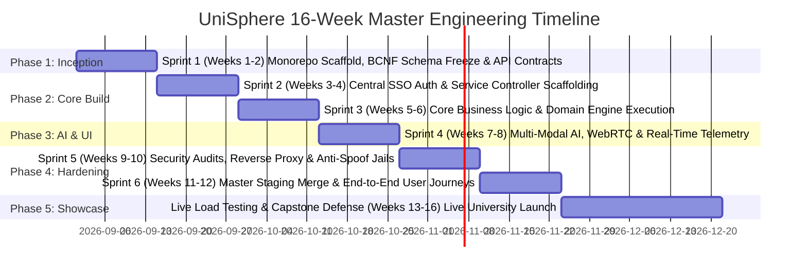

# UniSphere: Master Project Timeline & Team Workflow Dossier
## 16-Week Semester Engineering Roadmap, Sprint Deliverables & Multi-Team Integration Protocol
**Authoritative Architectural Specification | 7 Teams • 21 Student Engineers | Academic Year 2026-27**

---

## Executive Summary & Governance Model

The UniSphere platform unifies 7 specialized university subsystems into a high-performance, autonomous campus ecosystem. To enable **7 independent student teams (3 engineers per team, total 21 developers)** to build concurrently without blocking each other or encountering merge conflicts, the project adheres to a **16-Week Agile Engineering Lifecycle** governed by strict OpenAPI contracts, shared Turborepo packages, and an Ingress API Gateway.



---

## 1. 16-Week Master Engineering Timeline (6 Sprints)

| Sprint / Phase | Weeks | Milestone Focus | Deliverables & Quality Gates |
| :--- | :---: | :--- | :--- |
| **Sprint 1** | Weeks 1 – 2 | **Inception & Contract Freeze** | Turborepo monorepo scaffold, PostgreSQL 16 schema validation, Prisma migrations, shared `packages/ui` setup, OpenAPI 3.0 contract freeze. |
| **Sprint 2** | Weeks 3 – 4 | **Core Backend & SSO Auth** | Central JWT SSO authentication, role-based access control (RBAC), Express/FastAPI controllers, database CRUD operations, Next.js layouts. |
| **Sprint 3** | Weeks 5 – 6 | **Domain Core Engine Execution** | Leave state machine (Team 1), 5s rotating QR & Geofence (Team 2), Lockdown exam shell (Team 3), gVisor Docker sandbox runner (Team 4). |
| **Sprint 4** | Weeks 7 – 8 | **AI & Real-Time Telemetry** | WebRTC presentation room (Team 5), pgvector RAG pipeline (Team 6), Git HTTP smart protocol (Team 7), WebSocket telemetry and auto-save. |
| **Sprint 5** | Weeks 9 – 10 | **Security & Gateway Ingress** | Reverse proxy routing, Redis token blacklist, OWASP security audit, anti-spoofing tests, automated Jest test suites (>80% coverage). |
| **Sprint 6** | Weeks 11 – 12 | **Master Staging Merge & E2E** | Merge all 7 modules into staging branch, attendance-to-exam eligibility gating, slide-to-speech viva evaluation, unified UI theming. |
| **Phase 5** | Weeks 13 – 16 | **Load Testing & Live Showcase** | Simulate 500 concurrent users, live faculty demonstration, student capstone defense, disaster recovery drill, final production release. |

---

## 2. Master Integration Blueprint: How Teams Combine Everything

### 2.1 Monorepo Workspace Architecture (Turborepo)
```
unisphere-monorepo/
 apps/
 web-portal/ # Central Next.js 14 Unified Portal (SSO & Master Shell)
 hrms-service/ # Module 1: Team 1 (Express.js API)
 attendance-service/ # Module 2: Team 2 (Express.js + Redis QR Nonces)
 exam-service/ # Module 3: Team 3 (Express.js + WebSocket Server)
 judge-service/ # Module 4: Team 4 (BullMQ Worker + Docker Runner)
 presentation-service/ # Module 5: Team 5 (WebRTC LiveKit + FastAPI AI Evaluator)
 ai-bot-service/ # Module 6: Team 6 (FastAPI RAG Engine)
 unihub-service/ # Module 7: Team 7 (Git HTTP Server & Paper Archive)
 packages/
 ui/ # Shared Tailwind CSS / Shadcn UI Component Primitives
 auth/ # Shared JWT Token Verification & RBAC Middleware
 database/ # Shared Prisma Schema & PostgreSQL Migrations
 types/ # Shared TypeScript Interfaces (User, Course, Role)
 tsconfig/ # Standard TypeScript configurations across all workspaces
 docker-compose.yml # Local full-stack developer orchestration
 package.json # Turborepo root workspace configuration
```

### 2.2 Cross-Module Integration Contracts & Data Flows

```mermaid
graph TB
 subgraph AuthLayer ["Central Identity Provider"]
 SSO["JWT SSO Provider<br/>(packages/auth)"]
 end

 subgraph ServiceModules ["7 Independent Microservice Modules"]
 M1["Module 1: HRMS & Workforce"]
 M2["Module 2: Smart Attendance"]
 M3["Module 3: Exam Suite"]
 M4["Module 4: Code Arena Judge"]
 M5["Module 5: Presentation AI"]
 M6["Module 6: RAG Knowledge Bot"]
 M7["Module 7: UniHub Git & Papers"]
 end

 SSO -->|Bearer Tokens & Role Claims| M1 & M2 & M3 & M4 & M5 & M6 & M7

 M2 -->|1. Attendance % Check<br/>(Gate 75% Rule)| M3
 M3 -->|2. Exam Scores & Grades| M1
 M4 -->|3. Lab Code Grades| M1
 M5 -->|4. Capstone Defense Dossier| M7
 M6 -->|5. Ingest Syllabus & Policies| M1 & M2 & M3 & M5
```

1. **Attendance → Exam Gate (Contract 1)**: The Exam Engine calls Module 2's `/api/v1/attendance/eligibility/:studentId/:courseId`. If the effective attendance percentage is `<75%` without approved medical condonation, exam session initialization is hard-locked.
2. **Exams & Code Submissions → Student Dossier (Contract 2)**: Both Module 3 and Module 4 write validated scores directly into normalized student grade tables, rendering unified transcripts inside Module 1 HRMS.
3. **Presentation Defense → UniHub Capstone Archive (Contract 3)**: Upon completing an oral defense in Module 5, the WebRTC session recording, slide deck, and AI viva score dossier are automatically attached to the student's project repository in Module 7.
4. **RAG Knowledge Assistant → Campus Ecosystem (Contract 4)**: Module 6 ingests all academic handbooks, exam guidelines, HR leave policies, and programming assignment documentation, providing role-scoped assistance across the portal.

---

## 3. Team-Wise Workflows & Detailed Student Role Assignments

### Team 1: Enterprise Academic HRMS & Staff Attendance (EduHRMS)
- **Assigned Features**: Faculty/staff dossiers, leave application state machines, attendance regularization, payroll PDF generation, teaching credit workload balancing.
- **Student 1 (Frontend & UX Lead)**:
 - *Sprint 1*: Wireframe faculty profile dossier and leave application modal in Figma/Shadcn.
 - *Sprint 2*: Build responsive personal profile page, tenure history tabs, and emergency contact forms.
 - *Sprint 3*: Develop interactive leave request dialog with dynamic balance calculator and status tracker.
 - *Sprint 4*: Build staff attendance dashboard with geolocation map pins and regularization requests.
 - *Sprint 5*: Create payroll history view with PDF payslip download button and breakdown cards.
 - *Sprint 6*: Harmonize UI theme with master web portal and conduct accessibility testing.
- **Student 2 (Backend & API Lead)**:
 - *Sprint 1*: Review OpenAPI specs for HRMS and implement mock endpoints in Express.
 - *Sprint 2*: Build faculty profile CRUD controllers and Zod request validation schemas.
 - *Sprint 3*: Implement multi-stage leave approval state machine (Faculty → HOD → Dean → HR).
 - *Sprint 4*: Build teaching workload balancing algorithm calculating lecture, lab, and committee credits.
 - *Sprint 5*: Develop payroll calculation engine (basic pay, PF deduction, tax slabs, research allowances).
 - *Sprint 6*: Optimize database queries, build integration tests with Jest, and assist staging merge.
- **Student 3 (DevOps, Security & Data Lead)**:
 - *Sprint 1*: Deploy PostgreSQL 16 schema for HRMS and run initial Prisma migrations.
 - *Sprint 2*: Implement RBAC middleware verifying JWT tokens for SUPER_ADMIN, DEAN, HOD, and FACULTY.
 - *Sprint 3*: Build automated PDF payslip generation pipeline using PDFKit and stream to client.
 - *Sprint 4*: Set up immutable audit logging table recording salary changes and leave overrides.
 - *Sprint 5*: Harden endpoints against SQL injection and configure Docker Compose service container.
 - *Sprint 6*: Configure GitHub Actions CI pipeline and validate 0 lint/type errors.

---

### Team 2: Smart Student Attendance Tracking & Exam Eligibility (EduAttend AI)
- **Assigned Features**: 5-second rotating cryptographic QR codes, GPS geofencing, MediaPipe face liveness, medical leave condonation OCR, automated 75% exam gate.
- **Student 1 (Frontend & Scanner UX Lead)**:
 - *Sprint 1*: Design classroom projector display UI and mobile camera scanning view.
 - *Sprint 2*: Implement mobile QR scanner using react-qr-reader with smooth camera permissions.
 - *Sprint 3*: Build dynamic QR projection screen with real-time countdown radial progress bar (5s refresh).
 - *Sprint 4*: Create student course-wise attendance dashboard showing current percentage and warning badges.
 - *Sprint 5*: Build medical certificate upload portal with preview and doctor note attachment.
 - *Sprint 6*: Integrate defaulter alert banner and finalize UI for mobile PWA usage.
- **Student 2 (Backend & Geo-Fencing Architect)**:
 - *Sprint 1*: Set up Redis connection for ephemeral QR nonces and define attendance API contracts.
 - *Sprint 2*: Build classroom session creation endpoints with start/end time and GPS polygon boundaries.
 - *Sprint 3*: Implement 5-second rotating HMAC-SHA256 QR token generator and verification endpoint.
 - *Sprint 4*: Implement point-in-polygon algorithm to verify student coordinates are within classroom.
 - *Sprint 5*: Build automated course attendance percentage aggregator and 75% exam eligibility service.
 - *Sprint 6*: Implement WebSockets live headcount broadcast to faculty dashboard and optimize load.
- **Student 3 (AI Vision, Security & Condonation Lead)**:
 - *Sprint 1*: Research MediaPipe face mesh and design tablet kiosk check-in pipeline.
 - *Sprint 2*: Implement facial liveness detection (blink and iris tracking) to defeat photo/video spoofing.
 - *Sprint 3*: Implement mock GPS detection inspecting Android/iOS Location Provider APIs (`isFromMockProvider`).
 - *Sprint 4*: Integrate Tesseract OCR for automated medical certificate text extraction and hospital validation.
 - *Sprint 5*: Set up automated SMS/email defaulter notification relay triggered at <75% attendance.
 - *Sprint 6*: Configure Docker container for attendance service and run security penetration tests.

---

### Team 3: AI-Proctored Intelligent Examination Suite (EduExam AI)
- **Assigned Features**: Fullscreen lockdown exam shell, KaTeX formula editor, MediaPipe face/gaze telemetry, network-resilient auto-save, automated objective grading.
- **Student 1 (Frontend & Exam Shell Lead)**:
 - *Sprint 1*: Design distraction-free examination layout and question navigation palette.
 - *Sprint 2*: Implement fullscreen lockdown mode with event listeners blocking Alt+Tab, Ctrl+C, Ctrl+V.
 - *Sprint 3*: Build KaTeX math formula rendering and rich-text question display supporting images.
 - *Sprint 4*: Implement client-side IndexedDB answer caching to survive sudden network disconnections.
 - *Sprint 5*: Build synchronized exam countdown timer with warning modals and auto-submit trigger.
 - *Sprint 6*: Integrate with Central Gateway and polish student examination report view.
- **Student 2 (Backend & Telemetry Architect)**:
 - *Sprint 1*: Model exam assessment, question banks, and submission tables in Prisma.
 - *Sprint 2*: Build faculty question authoring studio endpoints with difficulty tags and randomized shuffling.
 - *Sprint 3*: Implement incremental answer auto-save endpoint with idempotency keys and timestamps.
 - *Sprint 4*: Build WebSocket heartbeat service monitoring active student connections and connectivity drops.
 - *Sprint 5*: Develop automated grading engine for MCQs/multi-select and rubric grading interface for essays.
 - *Sprint 6*: Connect to Module 2's attendance eligibility API to block ineligible students (<75%).
- **Student 3 (AI Proctoring & Integrity Specialist)**:
 - *Sprint 1*: Set up client-side MediaPipe face detection model running in Web Worker.
 - *Sprint 2*: Implement gaze deviation tracker flagging students looking away from screen >5 seconds.
 - *Sprint 3*: Build multi-person presence detector and missing face alert mechanism.
 - *Sprint 4*: Integrate background audio decibel analyzer flagging talking or whispering during exams.
 - *Sprint 5*: Build encrypted violation snapshot upload service and automated academic integrity score rating.
 - *Sprint 6*: Dockerize exam service, configure Redis caching, and execute load testing.

---

### Team 4: Cloud Code Execution Arena & Auto-Judge (EduCode Judge)
- **Assigned Features**: Monaco Editor integration, gVisor container sandbox runner, multi-tier test case judge (TLE, MLE, WA, AC), AST plagiarism detection engine.
- **Student 1 (Frontend & IDE Architect)**:
 - *Sprint 1*: Integrate Monaco Editor (@monaco-editor/react) with language switcher (Python, C++, Java, JS).
 - *Sprint 2*: Build customizable editor themes, font size toggles, keyboard shortcuts, and code auto-save.
 - *Sprint 3*: Create interactive stdin input panel and tabbed stdout/stderr execution result console.
 - *Sprint 4*: Build problem description view with Markdown rendering, constraints, and sample test cases.
 - *Sprint 5*: Create competitive practice track with difficulty filters, user streak counter, and leaderboards.
 - *Sprint 6*: Harmonize IDE styles with master portal and test cross-browser responsiveness.
- **Student 2 (Judge Backend & Task Queues)**:
 - *Sprint 1*: Configure BullMQ distributed task queue in Redis for async code execution requests.
 - *Sprint 2*: Implement submission dispatcher pushing code payloads to worker queues.
 - *Sprint 3*: Build test case evaluator comparing student output against expected output (handling whitespace).
 - *Sprint 4*: Implement execution verdict generator (Accepted, Wrong Answer, TLE, Memory Limit Exceeded).
 - *Sprint 5*: Build faculty assignment creation portal with private test cases and deadline rules.
 - *Sprint 6*: Optimize queue throughput to process 50 submissions per second and write unit tests.
- **Student 3 (Sandbox Security & AST Plagiarism Specialist)**:
 - *Sprint 1*: Install and configure gVisor (runsc) runtime on Docker host machine.
 - *Sprint 2*: Build ephemeral Docker worker node with `--network none` and `--read-only` root filesystem.
 - *Sprint 3*: Enforce hard cgroups limits: 256MB RAM, 1.0 CPU core, and `--pids-limit 64` to block fork bombs.
 - *Sprint 4*: Mount in-memory tmpfs (`/tmp:rw,size=16m`) for compiled binaries, auto-purged upon termination.
 - *Sprint 5*: Build Python AST tokenization and Winnowing algorithm to detect structural code plagiarism.
 - *Sprint 6*: Conduct penetration testing attempting container breakout and write security documentation.

---

### Team 5: AI Presentation & Virtual Viva Platform (EduPresent AI)
- **Assigned Features**: Live WebRTC presentation room, slide sync with laser pointer, Whisper speech pace/filler-word analysis, eye contact tracking, AI viva question generator.
- **Student 1 (WebRTC Studio & Presentation Lead)**:
 - *Sprint 1*: Design virtual presentation stage with presenter video tile, slide canvas, and attendee grid.
 - *Sprint 2*: Build WebRTC audio/video client using LiveKit/Mediasoup SDK with mic/cam toggles.
 - *Sprint 3*: Integrate PDF.js viewer with real-time slide synchronized broadcasting across all viewers.
 - *Sprint 4*: Build presenter laser pointer and drawing tool synchronized over WebRTC data channels.
 - *Sprint 5*: Create evaluator rubric scoring panel with criteria sliders (Delivery, Content, Visuals, Q&A).
 - *Sprint 6*: Build student presentation history dashboard with downloadable AI feedback dossiers.
- **Student 2 (Multi-Modal AI Pipeline Architect)**:
 - *Sprint 1*: Build FastAPI service for audio chunking and speech-to-text transcription.
 - *Sprint 2*: Deploy OpenAI Whisper / Vosk pipeline transcribing live presentation audio in real time.
 - *Sprint 3*: Build vocal pace analyzer calculating words per minute (WPM) and flagging rushed/slow delivery.
 - *Sprint 4*: Implement filler-word detector counting occurrences of 'um', 'uh', 'like', and 'you know'.
 - *Sprint 5*: Build AI viva question generator: extracts key topics from transcript and generates technical Qs.
 - *Sprint 6*: Implement student viva response transcription and evaluate conceptual correctness score.
- **Student 3 (Computer Vision & Slide Alignment Specialist)**:
 - *Sprint 1*: Implement MediaPipe face and gaze tracker measuring student camera eye contact percentage.
 - *Sprint 2*: Build posture and fidgeting detector evaluating professional presentation body language.
 - *Sprint 3*: Extract slide text and images; compute vector semantic alignment between speech and slides.
 - *Sprint 4*: Enforce DTLS-SRTP encryption on media streams and generate dynamic viewer watermarks on slides.
 - *Sprint 5*: Build automated PDF report generator combining all multi-modal metrics into an executive dossier.
 - *Sprint 6*: Configure MinIO S3 bucket for presentation video archives and configure Docker containers.

---

### Team 6: Institutional Knowledge Base & Conversational AI Assistant (EduAssist AI)
- **Assigned Features**: Document ingestion pipeline, PostgreSQL pgvector semantic search, hallucination-guarded RAG chatbot, role-based privacy filters, AI coding tutor.
- **Student 1 (Conversational UX Lead)**:
 - *Sprint 1*: Design modern streaming chat interface with message bubbles, avatars, and input bar.
 - *Sprint 2*: Implement streaming text output using Server-Sent Events (SSE) for zero-latency response display.
 - *Sprint 3*: Build Markdown renderer supporting code blocks, tables, and KaTeX mathematical formulas.
 - *Sprint 4*: Create clickable source citation cards showing the exact university document and page number.
 - *Sprint 5*: Build student coding tutor mode with hint buttons and concept explanation toggles.
 - *Sprint 6*: Implement user feedback thumbs up/down buttons and integrate chat widget into portal layout.
- **Student 2 (RAG Ingestion & Pipeline Lead)**:
 - *Sprint 1*: Build document upload portal for PDF, DOCX, and TXT files with metadata tagging.
 - *Sprint 2*: Implement recursive character text splitter chunking documents into 500-token semantic chunks.
 - *Sprint 3*: Build embedding generation pipeline using OpenAI / Gemini / HuggingFace embedding models.
 - *Sprint 4*: Implement hybrid search combining pgvector cosine similarity with full-text BM25 keyword search.
 - *Sprint 5*: Construct strict system prompts anchoring responses strictly to retrieved university context.
 - *Sprint 6*: Build unanswered query escalation workflow creating support tickets for campus helpdesk.
- **Student 3 (Vector Database & Prompt Security Specialist)**:
 - *Sprint 1*: Enable PostgreSQL pgvector extension and create `ai_document_chunks` table with HNSW index.
 - *Sprint 2*: Implement role-scoped search partitions (e.g., student queries cannot access faculty salary data).
 - *Sprint 3*: Build prompt injection defense filter sanitizing adversarial user inputs.
 - *Sprint 4*: Set up Redis caching for frequent campus queries (e.g., academic calendar dates) to reduce latency.
 - *Sprint 5*: Build administrative analytics dashboard tracking top student queries and knowledge gaps.
 - *Sprint 6*: Dockerize FastAPI RAG service and benchmark query response times under load.

---

### Team 7: UniHub Git Repository & Research Archive (UniHub)
- **Assigned Features**: Web Git repository hosting, commit graphs, side-by-side diffs, capstone project showcase, research paper pre-prints, campus innovation feed.
- **Student 1 (Git Web UI & Discovery Lead)**:
 - *Sprint 1*: Design repository overview page with file explorer, README preview, and clone URL bar.
 - *Sprint 2*: Build interactive file tree navigation and syntax-highlighted code file viewer.
 - *Sprint 3*: Implement visual commit branch graph and side-by-side code diff viewer.
 - *Sprint 4*: Build capstone project exhibition gallery with technology tags, star ratings, and demo links.
 - *Sprint 5*: Create research paper reader with embedded PDF viewer and copyable BibTeX citation modal.
 - *Sprint 6*: Build live campus innovation feed ('Happening Now') showing recent commits and publications.
- **Student 2 (Git Engine & Paper Indexer)**:
 - *Sprint 1*: Set up isomorphic-git / nodegit backend to handle Git smart HTTP packfiles (push/pull).
 - *Sprint 2*: Build repository creation wizard with options to initialize README and license files.
 - *Sprint 3*: Implement commit history parser extracting commit hash, author, timestamp, and diff chunks.
 - *Sprint 4*: Build branch management and tag creation API endpoints.
 - *Sprint 5*: Implement research manuscript upload pipeline extracting title, abstract, and DOI metadata.
 - *Sprint 6*: Build automated BibTeX citation generator and write unit tests for Git HTTP transfer.
- **Student 3 (Storage, Activity Feeds & Security Specialist)**:
 - *Sprint 1*: Configure MinIO S3 object storage for bare Git repositories and research manuscript PDFs.
 - *Sprint 2*: Build real-time event broadcaster streaming repo pushes, stars, and papers to campus feed.
 - *Sprint 3*: Implement repository access control policies (Public, Departmental, Private).
 - *Sprint 4*: Build automated secret scanning linter detecting accidentally committed API keys or passwords.
 - *Sprint 5*: Set up repository backup and replication schedules to prevent intellectual property loss.
 - *Sprint 6*: Dockerize UniHub service, configure NGINX reverse proxy, and validate CI/CD pipelines.

---

## 4. Git & GitHub Engineering Collaboration Protocol

### 4.1 Branching Convention
- `team<N>/feat-<feature-name>` for all new feature additions.
- `team<N>/fix-<bug-name>` for bug fixes and patches.
- `staging` as the central integration branch.
- `main` as the production release branch.

### 4.2 Definition of Done (DoD) Checklist
Every Pull Request must satisfy the following automated and peer criteria before merging:
1. [x] Zero ESLint warnings (`pnpm lint`).
2. [x] Zero TypeScript type errors (`tsc --noEmit`).
3. [x] Minimum 80% unit test line coverage (`pnpm test`).
4. [x] Prisma database migrations tested and committed.
5. [x] Two approving peer reviews (including one teammate + one architect/peer).
6. [x] Zero broken user flows or placeholder buttons.

---

## 5. Summary of Workspace Files

| File | Format | Purpose |
| :--- | :---: | :--- |
| **`UNISPHERE_PROJECT_ROADMAP.pptx`** | PowerPoint Presentation | 15-slide executive presentation covering vision, timeline, 7 team workflows, integration, and grading rubrics. |
| **`PROJECT_TIMELINE_AND_WORKFLOW.docx`** | Word Document | Comprehensive guide with tables and complete student role assignments. |
| **`PROJECT_TIMELINE_AND_WORKFLOW.md`** | Markdown Document | Version-controlled repository reference with Gantt and flow diagrams. |
| **`university_projects_catalog_updated.xlsx`** | Excel Spreadsheet | Complete 7-project assignment catalog formatted with exact required Google Form headers. |
| **`university_portal_master_architecture.docx`** | Word Document | Full system architecture, normalized database DDL, API documentation, and security audit. |
